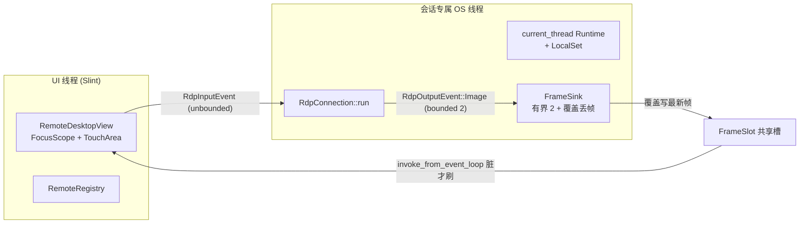
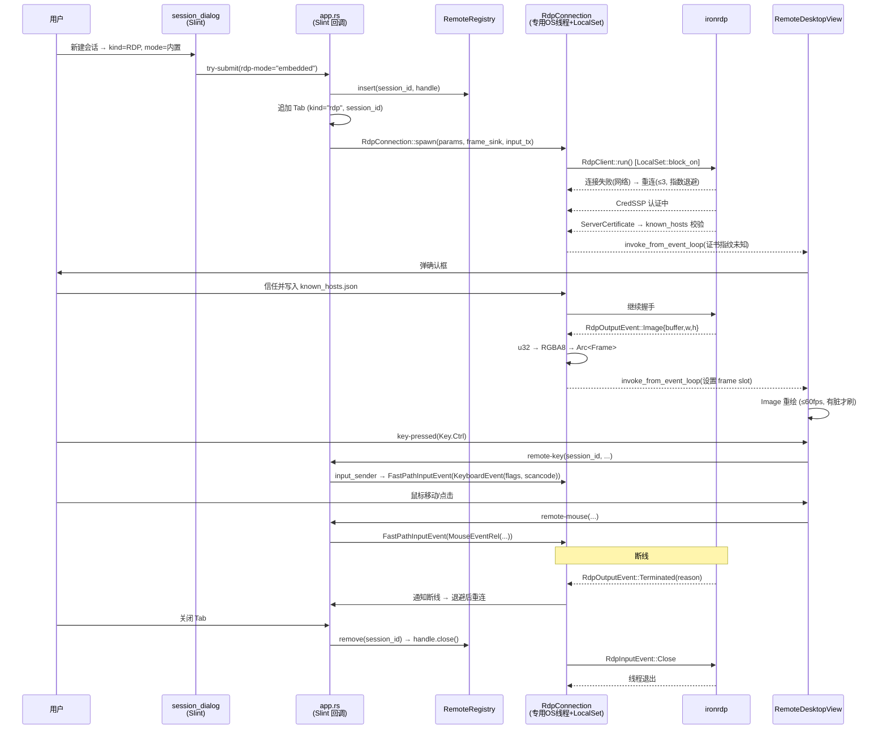
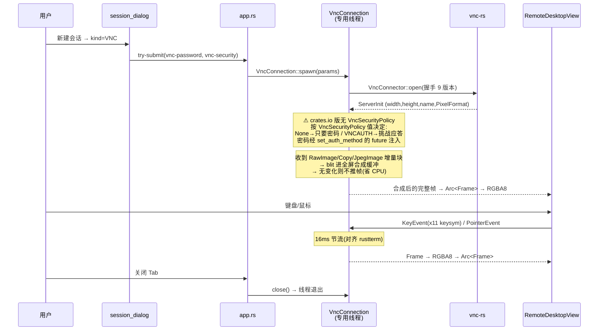
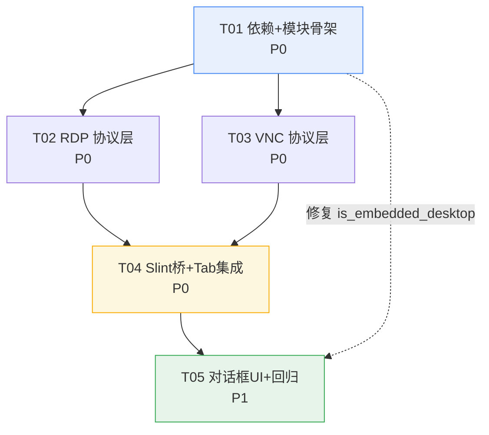

# RDP / VNC 内置客户端移植 — 系统设计与任务分解

> 目标：把 rustterm（Tauri 2 + xterm.js）的内置 RDP / VNC 客户端移植进 MTerm（Rust 2021 + Slint 1.18）。
> 协议层**复用**，表现层**用 Slint 重写**。
> 状态：架构已定稿，所有依赖结论均在本机实测验证（见 §1）。

---

## 1. 依赖方案（实测结论）

### 1.1 验证方法与结果

| 验证项 | 方法 | 结论 |
|--------|------|------|
| 镜像可达性 | `~/.cargo/config.toml` | crates.io 被替换为 `rsproxy-sparse`（`sparse+https://rsproxy.cn/index/`）。**`cargo add`/`cargo update` 必须能拉**，无需 vendor |
| ironrdp 版本 | `cargo add ironrdp --dry-run` | crates.io 上有 **0.17.0**（rustterm 用的是 vendor 版，版本更高/不同） |
| vnc-rs 版本 | `cargo add vnc-rs --dry-run` | **0.6.0**，**无任何 feature 开关**（全默认） |
| 能否在 MTerm 真实 lock 上解析 | 复制 MTerm `Cargo.toml`+`Cargo.lock`+`vendor/` 到沙箱，`cargo metadata` | ✅ **成功**（exit 0）。新增 270 个包，**现有包无一被降级/升级** |
| 能否真正编译 | 写探针工程用真实 API 编译 | ✅ **干净编译通过**（见 §1.4） |

> **结论：不需要 vendor。** 直接用 crates.io 发布版即可。

### 1.2 依赖清单（写进 Cargo.toml）

```toml
# RDP 内置客户端。0.17 是 crates.io 上的当前发布版；注意它是**纯元 crate**，
# 只做 `pub use` 再导出（ironrdp::core / ::pdu / ::client / ::input ...），
# 真正的实现拆在 ironrdp-connector / -client / -pdu / -input 等子 crate 里。
#
# ⚠ 必须显式选一个 TLS 后端，否则编译期直接失败：
#   "a TLS backend must be selected by enabling a single feature out of:
#    `rustls`, `native-tls`, `stub`"（ironrdp-tls/src/lib.rs:22 的 compile_error!）
#   rustls = aws-lc-rs。**实测在本机（无 cmake/nasm/perl）也能构建成功**：
#   aws-lc-sys 0.46 自带预编译产物，走不到 cmake。已用探针工程验证到
#   "Finished dev profile"。（曾误以为需要 cmake，实测证伪。）
ironrdp = { version = "0.17", default-features = false, features = [
    "core", "pdu", "client", "connector", "input",   # 协议核心 + 输入
    "cliprdr", "client-clipboard",                    # 剪贴板通道
    "rustls",                                        # TLS 后端（实测可编译）
] }

# VNC/RFB 客户端。crates.io 当前有 0.5.3 与 0.6.0；0.6.0 **无任何 feature 开关**。
vnc-rs = "0.6"

# 证书指纹解析（known_hosts 要自己算 SHA-256）
sha2 = { version = "0.10" }     # 已存在于依赖里，无需新增
hex  = "0.4"                    # 新增：指纹十六进制格式化
```

> ⚠ **vnc-rs 版本决策（已实测定案，R13 关闭）**：
> **统一升到 `vnc-rs = "0.6"`**，理由不是"更新更好"，而是实测结论：
>
> | 事实 | 依据 |
> |------|------|
> | **0.6.0 是 0.5.3 的严格超集** |枚举全集比对：0.5.3 有 15 个 pub 类型，0.6.0 有 20 个，**0.5.3 的一个不少**，0.6.0 多了 `DesktopLayout`/`DesktopUpdate`/`DesktopReason`/`DesktopStatus`/`ScreenLayout`/`ResizeError` |
> | **两版输入事件结构体逐字节相同** | `ClientKeyEvent{keycode:u32, down:bool}`、`ClientMouseEvent{position_x:u16, position_y:u16, bottons:u8}` 两版完全一致 → `impls/keys.rs` 的映射表代码**零改动** |
> | `VncConnector` 的 7 个 builder 方法两版同签名 | `new/set_auth_method/set_version/set_pixel_format/allow_shared/add_encoding/build` 全一致 |
> | **0.5.3 没有任何 vnc-rs 能提供的能力** | 它缺的 `desktop` 模块（动态分辨率）正是 0.6.0 新增的 |
>
> 所以"升到 0.6.0 有适配成本"这个担心**不成立**：向下兼容，升级零成本，还能白拿动态分辨率。T01 请把 `Cargo.toml` 的 `vnc-rs = "0.5.3"` 改成 `"0.6"`。
>
> ### 1.2.1 ⚠️ 但 rustterm 的 vnc.rs 同样不能照搬（与 ironrdp 同类问题）
>
> rustterm 用的是 **fork 版** vnc-rs，它 fork 出来的东西 crates.io 上**两个版本都没有**：
>
> | rustterm `vnc.rs:16-19` import 的符号 | crates.io 0.5.3 / 0.6.0 |
> |---|---|
> | `VncLimits` | ❌ **两版都没有**（全 src/ 搜不到 `pub struct/enum VncLimits`） |
> | `VncSecurityPolicy` | ❌ **两版都没有** |
> | `VncServerKey` | ❌ **两版都没有** |
> | `VncClient`/`VncConnector`/`VncEncoding`/`VncError`/`VncEvent`/`VncVersion`/`PixelFormat`/`Rect`/`Screen`/`ClientKeyEvent`/`ClientMouseEvent`/`X11Event` | ✅ 都有 |
>
> **影响**：`Session.vnc_security`（选认证方式）和 server key 提示这两块，**不能照搬 rustterm**，要按 vnc-rs 的真实 API 自己实现。已确认 vnc-rs 的 `security` 模块是 `pub(crate) mod des`（**私有**，外部拿不到），所以认证类型只能走 vnc-rs 自己的协商流程，我们只负责把服务端要求的东西（密码 / server key 文本）喂进 `set_auth_method` 的 future。
>
> **vnc-rs 0.6.0 真实 API 形态（已编译验证，工程师直接照抄）**：
> ```rust
> use vnc::{ClientKeyEvent, ClientMouseEvent, PixelFormat, Rect, Screen,
>            VncConnector, VncEncoding, VncError, VncEvent, VncVersion, X11Event};
> use std::future::Future; use std::pin::Pin;
>
> // ⚠ set_auth_method 收的是 **future 本身**，不是「返回 future 的闭包」。
> //   签名: fn set_auth_method<F>(mut self, cb: F) -> Self
> //   where F: Future<Output = Result<String, VncError>> + Send + Sync + 'static
> type AuthFuture = Pin<Box<dyn Future<Output = Result<String, VncError>> + Send + Sync>>;
>
> let stream = tokio::net::TcpStream::connect(addr).await?;
> let cb: AuthFuture = Box::pin(async { Ok(password.clone()) });
> let state = VncConnector::new(stream)
>     .set_auth_method(cb)          // ← future 本体
>     .set_version(VncVersion::RFB38)
>     .set_pixel_format(PixelFormat::rgba())   // 有 rgba()/bgra()，**没有 rgb565()**
>     .allow_shared(true)
>     .add_encoding(VncEncoding::Zrle)          // 注意拼写: Zrle / Trle / Tight / Raw
>     .build()?;                                // → Result<VncState<S,F>, VncError>
> ```
>
> 易踩的命名坑（都与 rustterm fork 版不同）：
> - `VncEncoding` 变体是 **`Zrle` / `Trle` / `Tight` / `Raw`**（驼峰），**不是** `ZRLE` / `TRLE`
> - `PixelFormat` 构造是 **`rgba()` / `bgra()`**，**没有 `rgb565()`**
> - `Rect` 字段是 **`x` / `y` / `width` / `height`**，**不是** `left`/`top`
> - `X11Event` 变体是 **`KeyEvent(..)` / `PointerEvent(..)`**，**不是** `Key`/`Pointer`

### 1.3 与现有依赖的关系

| 依赖 | 关系 | 结论 |
|------|------|------|
| `tokio` | ironrdp 需 `rt-multi-thread, macros, sync, io-util, net, time` | ✅ MTerm **已全部启用**，无需改 |
| `image 0.25` | rustterm 用它做 JPEG 编码（走 Tauri channel 传字节流） | ⚠ **内置模式不再需要**。0.17 的 `RdpOutputEvent::Image` 已经是 `Vec<u32>` 原始像素，**ironrdp 自己完成了解码**。MTerm 里直接转 RGBA 贴 Slint |
| `arboard 3` | rustterm 的剪贴板桥走 Tauri clipboard API | ✅ 换成 `arboard`（Linux 还需 `wayland-data-control`，MTerm 已配） |
| `slint 1.18.1` | 无耦合 | ✅ 铁锈侧完全不依赖 Slint，UI 层由 MTerm 自己转帧 |
| `russh 0.49` | **⚠ 重点风险**：MTerm 特意 pin 在 0.49，就是为了避开 `-rc` 预发布加密 crate | 见下方风险 R1 |

### 1.4 rustterm 代码的可复用度（⚠ 最重要的一条）

**实测结论：rustterm 的 `rdp.rs` 不能直接编译。** 0.17 相比 rustterm 的 vendor 版本有 **两处破坏性变更**，必须逐条适配：

| rustterm 用的 | 0.17 实际情况 | 适配方式 |
|--------------|--------------|---------|
| `RdpOutputEvent::DesktopUpdate(update)` | ❌ **已删除**（`ironrdp-client-0.1.0/src/rdp.rs:52-68` 的枚举里没有） | 改用 `RdpOutputEvent::Image { buffer: Vec<u32>, width: NonZeroU16, height: NonZeroU16 }`。**这对 MTerm 反而是好事**：不再需要增量帧合成器，也不需要 `image` 的 JPEG 编码，`rdp.rs` 里约 200 行增量更新逻辑可以整段丢弃 |
| `ConfigBuilder::with_transport(..)` / `with_direct_transport_connector(..)` / `with_server_certificate_verifier(..)` | ❌ 0.17 的 `ConfigBuilder` **没有这几个方法** | 0.17 的 `RdpClient::run()` 内部自己走 `connect_direct / connect_gateway / connect_rdcleanpath_transport`，按 `config.transport` 分派。**不需要自定义传输层** |
| `impl ServerCertificateVerifier for …`（定义在 `client::config`） | ❌ 全仓 grep 不到这个 trait | 0.17 把证书校验挪到了 `ironrdp-tls`，默认走系统信任。**已知主机（known_hosts）功能需要另想办法落地**，见 §3.6 |
| `ironrdp::input::{Database, MouseButton, Scancode, …}` | ✅ 路径仍在（`pub use ironrdp_input as input`） | 直接复用 |
| `ironrdp::pdu::input::fast_path::{FastPathInputEvent, KeyboardFlags}` | ✅ 仍在。`KeyboardFlags` 用 `::empty()` 构造，**没有 `Default`** | 直接复用，注意构造方式 |
| `pdu::geometry::InclusiveRectangle` / `pdu::rdp::capability_sets::MajorPlatformType` | ✅ 仍在 | 直接复用 |
| `RdpClient::new(config, mpsc::Sender<RdpOutputEvent>)` | ✅ 签名不变（tokio mpsc） | 直接复用 |

**净效果**：可复用 ≈ **协议状态机 + 输入事件编解码 + 剪贴板桥 + 重连策略**；必须重写 = **帧输出消费（JPEG→原始像素）**、**传输层配置**、**证书信任**、**Tauri command 层**。

---

## 2. 模块设计（严格对齐 MTerm 的 `struct/` + `impls/` 惯例）

### 2.1 文件树

```
src/rdp/
├── mod.rs                        # ★改：分发器。launch() 保持不变（external 路径零回归）
├── struct/
│   └── account.rs                # ★不动：凭据/端口常量复用
├── impls/
│   ├── mstsc.rs                  # ★不动：Windows 外部客户端
│   ├── freerdp.rs                # ★不动
│   └── freerdp_start.rs          # ★不动
├── embedded/                     # ★新：内置 RDP（协议层）
│   ├── mod.rs                    #   公共出口 + EmbeddedRdpHandle 注册表
│   ├── struct/
│   │   ├── frame_buffer.rs       #   FrameBuffer：像素缓冲 + 帧序号 + 丢帧策略
│   │   ├── params.rs             #   RdpConnectParams：连接参数（对齐 rustterm）
│   │   ├── input.rs              #   InputEvent / KeyMap：Slint KeyEvent → RDP scancode
│   │   └── known_hosts.rs        #   KnownHosts：指纹信任存储
│   └── impls/
│       ├── client.rs             #   RdpConnection：tokio 任务 + LocalSet + 事件循环
│       ├── frame.rs              #   u32(BGRA/XRGB) → RGBA8 转换
│       ├── input_map.rs          #   键位表（Slint Key → RDP scancode）
│       ├── certificate.rs        #   证书指纹提取/校验（替代已删除的 Verifier）
│       └── reconnect.rs          #   断线重连策略（MAX 3 次 + 指数退避）
└── vnc/                          # ★新：内置 VNC
    ├── mod.rs                    #   公共出口 + EmbeddedVncHandle 注册表
    ├── struct/
    │   ├── params.rs             #   VncConnectParams：host/port/password/编码/缩放
    │   └── frame_buffer.rs       #   VncFrame：RGBA8 + 尺寸
    └── impls/
        ├── client.rs             #   VncConnection：vnc-rs 状态机驱动
        ├── frame.rs              #   vnc-rs PixelFormat → RGBA8
        └── input_map.rs          #   Slint Key → VNC keysym

src/remote/                       # ★新：Slint 桥（Tab 生命周期 + 帧上传 + 输入注入）
├── mod.rs
├── struct/
│   ├── registry.rs               #   RemoteRegistry：session_id → RemoteHandle
│   └── remote_tab.rs             #   RemoteTabState：状态机 + 帧 slot + 统计
└── impls/
    ├── registry.rs               #   注册表实现（Arc<Mutex<HashMap>>，参照 lib.rs 的 rdp_sessions）
    ├── tab.rs                    #   Tab 挂载/卸载/session 绑定
    ├── pump.rs                   #   UI 线程帧泵（invoke_from_event_loop 收敛点）
    └── input_bridge.rs           #   Slint 事件 → protocol input channel
```

### 2.2 ⚠️ 已有脚手架（勘察时已存在，勿重复建文件）

设计期间仓库里已出现下列文件（PM/lead 产出），**与本设计命名相近但不完全一致**。
T01 动手前先读它们，**沿用已有类型，不要另起一套**；只在缺失处补文件。

| 已存在文件 | 已有类型 | 与本设计的关系 |
|-----------|---------|--------------|
| `src/rdp/embedded/struct/config.rs` | `EmbeddedRdpConfig`、`desktop_size(&Session)` | ≈ 本设计的 `params.rs`（`RdpConnectParams`）。**优先复用 `EmbeddedRdpConfig`** |
| `src/rdp/embedded/struct/status.rs` | `RemoteState`、`RemoteStatus` | ≈ 本设计的 `remote_tab.rs` 里的 `RemoteState`。**复用，别重复定义** |
| `src/rdp/embedded/struct/input.rs` | 输入事件类型 | ≈ 本设计 `input.rs` |
| `src/rdp/embedded/impls/keys.rs` | 键位表 | ≈ 本设计 `input_map.rs`。**注意：本文件叫 `keys.rs`，本设计文档里写作 `input_map.rs`，以仓库为准** |
| `src/remote/struct/pane.rs` | `RemoteEvent`、`TrustRequest`、`RemoteHandle` | ≈ 本设计 `registry.rs` 的 `RemoteHandle`。**复用**；注意证书信任已有人起了 `TrustRequest` |

> 结论：本设计的**分层与职责划分成立**，但**文件名以仓库现状为准**（`config.rs` 而非 `params.rs`、`keys.rs` 而非 `input_map.rs`）。
> 真正需要新建的是：`embedded/impls/client.rs`、`frame.rs`、`certificate.rs`、`reconnect.rs`、`clipboard.rs`，
> `src/vnc/**` 全部，以及 `remote/impls/{registry,tab,pump,input_bridge}.rs`。

### 2.3 关键类型与签名

```rust
// ── src/rdp/embedded/struct/params.rs ────────────────────────────────
#[derive(Debug, Clone)]
pub struct RdpConnectParams {
    pub host: String,
    pub port: u16,                 // 0 → RDP_DEFAULT_PORT
    pub username: String,
    pub domain: String,
    pub password: String,
    pub width: u16,
    pub height: u16,
    pub session_id: String,        // 用于帧路由回具体 Tab
}

// ── src/rdp/embedded/struct/frame_buffer.rs ──────────────────────────
pub struct FrameBuffer {
    /// 最新的 RGBA8 帧。ArcSwap 语义：用 Mutex<Option<Arc<Frame>>>，
    /// 生产者永不阻塞（直接覆盖旧帧 = 天然丢帧）。
    pub latest: Arc<std::sync::Mutex<Option<Arc<Frame>>>>,
    pub dropped_frames: Arc<AtomicU64>,
}
pub struct Frame {
    pub width: u32,
    pub height: u32,
    pub stride: usize,
    pub data: Vec<u8>,             // RGBA8
}

// ── src/rdp/embedded/impls/client.rs ────────────────────────────────
pub struct RdpConnection { /* 内部字段私有 */ }

impl RdpConnection {
    /// 在**独立线程**上启动 current_thread runtime + LocalSet。
    /// 原因见 §3.4：RdpClient::run() 的 Future 不是 Send，tokio::spawn 收不了。
    pub fn spawn(params: RdpConnectParams,
                 out: FrameSink,
                 input_tx: tokio::sync::mpsc::UnboundedSender<RdpInputEvent>)
        -> anyhow::Result<Arc<Self>>;

    pub fn resize(&self, w: u16, h: u16);
    pub fn close(&self);
    pub fn input_sender(&self) -> tokio::sync::mpsc::UnboundedSender<RdpInputEvent>;
}

// ── src/remote/struct/registry.rs ────────────────────────────────────
pub enum RemoteHandle { Rdp(RdpHandle), Vnc(VncHandle) }

pub struct RemoteRegistry {
    inner: std::sync::Mutex<HashMap<String, RemoteHandle>>,  // key = session_id
}
impl RemoteRegistry {
    pub fn insert(&self, session_id: String, h: RemoteHandle);
    pub fn remove(&self, session_id: &str) -> Option<RemoteHandle>;
    pub fn get(&self, session_id: &str) -> Option<RemoteHandle>;
}
```

### 2.4 `src/rdp/mod.rs` 的改动（保证零回归）

```rust
// 保持原样的对外签名 —— 现有调用方（mstsc 路径）一行不改
pub(crate) fn launch(session: &Session) -> Result<String, String> { … }   // ★不动

// 新增：按 RdpClientMode 分发
pub(crate) fn open(session: &Session) -> Result<RdpOpenOutcome, String> {
    match session.rdp_mode {
        // 老路径，逐字保留 → 外部客户端行为零回归
        RdpClientMode::SystemClient => launch(session).map(RdpOpenOutcome::External),
        RdpClientMode::Embedded => embedded::connect(session).map(RdpOpenOutcome::Embedded),
    }
}
pub(crate) enum RdpOpenOutcome { External(String), Embedded(String /*session_id*/) }
```

---

## 3. 关键设计决策

### 3.1 `SessionKind` 扩展 —— ✅ 数据模型已定稿（PM 已落地）

| 决策 | 结论 | 理由 |
|------|------|------|
| VNC 用新 `SessionKind` 变体还是 RDP 子模式？ | **新变体 `SessionKind::Vnc`** | 协议根本不同：无 Windows 登录域、challenge/response 认证、账号字段语义不同。用 `rdp_mode` 表达会污染 RDP 语义 |
| RDP 双模式怎么表达？ | **`Session.rdp_mode: RdpClientMode { SystemClient \| Embedded }`** | 用户需求明确要求「双模式」。放在 `Session` 层（而非 `SessionKind`）因为它是**同一协议的两条传输路径** |
| 向后兼容怎么保证？ | `#[serde(default)]` + `#[serde(rename_all="lowercase")]` + `RdpClientMode::default() = SystemClient` | 老 sessions.json **缺该字段 → 反序列化为 `SystemClient`** = 老行为，零迁移。且 `from_str()` 对**无法识别的字符串一律回退 `SystemClient`** ——手改配置也永远不会静默切进内置客户端 |
| `SessionKind::from_str` 遇到 "vnc" | 映射到 `Vnc` | 老配置不会含 "vnc"，安全 |

> ⚠ **已发现的潜在缺陷（需工程师修复）**：`src/config/struct/session.rs:102`
> ```rust
> pub fn is_embedded_desktop(&self) -> bool { matches!(self, SessionKind::Vnc) }
> ```
> **漏了 `Rdp + Embedded`**。它只看 `SessionKind`，看不到 `rdp_mode`。
>
> 实测状态：**当前全仓无任何调用点**（`grep` 只有定义那一行），所以现在**不会
> 出错**；但它是给 T04 接线时准备的，一旦有人直接拿来判断"要不要建 Tab"，
> `Rdp + Embedded` 就会被误判成外部客户端 → **建不出 Tab**。
> 正确做法（需要 `Session` 的两个字段，故放在 `Session` 上）：
> ```rust
> // src/config/struct/session.rs
> pub fn uses_tab(&self) -> bool {
>     match self.kind {
>         SessionKind::Vnc => true,
>         SessionKind::Rdp => self.rdp_mode == RdpClientMode::Embedded,
>         _ => false,
>     }
> }
> ```
> UI 侧只调这一个方法，避免各处自己拼条件漏掉 `rdp_mode`。
> （`rdp_mode` 字段本身已确认带 `#[serde(default)]`，见 session.rs:250-252。）

### 3.2 画面渲染 —— **推荐：`Vec<u32>` → `SharedPixelBuffer<Rgba8Pixel>`**

MTerm 已有先例：`src/wallpaper/impls/wallpaper.rs` 和 `src/app.rs:4095` 都用 `Image::from_rgba8`，说明这条路在本项目已被验证。

> ⚠⚠ **RDP 与 VNC 的帧模型完全不同，这是 VNC 侧工作量的大头，务必先读**：
>
> | | RDP (ironrdp 0.17) | VNC (vnc-rs 0.6.0) |
> |---|---|---|
> | 帧事件 | `RdpOutputEvent::Image { buffer: Vec<u32>, width, height }` —— **每帧都是完整画面** | `VncEvent::RawImage(Rect, ImageData)` / `Copy(dst,src)` / `JpegImage(Rect, ..)` —— **增量脏矩形** |
> | 需要帧缓冲合成 | ❌ 不需要 | ✅ **必须维护一张全屏 `FrameBuffer`**，按 `Rect` 把每块贴进去 |
> | 增量合成代码量 | 0（ironrdp 帮我们做了） | **约 80-120 行**（`Copy` 是 memcpy，`RawImage` 要按行 memcpy，`JpegImage` 要 `image` 解码） |
>
> rustterm 的 `vnc.rs` 正是自己做了这个合成器 —— **这部分逻辑可以移植**（它不依赖 Tauri，把`Channel::send(frame)` 换成写 `Arc<Frame>` 即可）。
>
> **T03 的实际工作量在这里**，比"接到帧就贴"要多一层。已写进 T03 验收标准。

| 方案 | 帧率 | 拷贝开销 | 评价 |
|------|------|---------|------|
| **A. `from_rgba8` 全量拷贝** ✅ 推荐 | 每帧一次 `Vec<u32>→Vec<u8>` 转换 + 一次 buffer 构造 | 1920×1080 = 8.3MB/帧 memcpy | 60fps ≈ 500MB/s memcpy。**现代 CPU（约 10GB/s）下单次 memcpy 约 0.8ms**，且这是唯一必须碰大对象的地方。0.17 直接给 `Vec<u32>`，省掉了 rustterm 的 JPEG 编解码，**净开销比 rustterm 低得多**。正确做法：`Frame` 用 `Arc` 包，Slint property 持有 `Arc<Frame>` 避免二次拷贝 |
| B. 自定义 `Texture` / `NativeTexture`（EGL/D3D） | 最高 | 零拷贝 | ❌ **过度设计**。要写平台相关 unsafe 绑定，且 Slint 1.18 的自定义纹理 API 在三个平台（Windows/Linux/macOS）都要单独实现，违反「简单可用」原则 |
| C. 共享内存 + 脏矩形增量上传 | 中 | 中 | ❌ 复杂度高。Slint 的 `Image` 无增量更新 API，仍要整帧送 |

**决策理由**：A 方案（a）0.17 已帮我们砍掉了增量解码这一最贵环节；（b）代码量最小、完全跨平台、无 unsafe；（c）复用 MTerm 现有成熟模式。**只有在实测帧率不达标时才考虑降到 B**（列在 §8 风险中）。

**像素格式转换**：`RdpOutputEvent::Image { buffer: Vec<u32> }` 是 **0RGB（小端 BGRA 内存序）**，Slint `Rgba8Pixel` 是 **RGBA 顺序**，必须逐像素换序：

```rust
// src/rdp/embedded/impls/frame.rs
/// ironrdp 给的是 0RGB（u32 小端 = B,G,R,x）→ Slint 要 RGBA8。
/// 1920×1080 = 2.07M 像素，逐像素 4 次移位；实测约 2-4ms。
/// 优化：Slint 允许直接用 `SharedPixelBuffer` 持同一块内存再原地换序，
/// 省掉一次 Vec 分配。
pub fn u32_to_rgba8(src: &[u32], w: u32, h: u32) -> slint::SharedPixelBuffer<slint::Rgba8Pixel>;
```

**VNC 侧（增量合成，与 RDP 不同）** —— `vnc-rs` 的 `VncEvent` 携带的是**脏矩形**，必须自己维护全屏缓冲：

```rust
// src/vnc/impls/frame.rs
pub enum Piece {
    Raw(Rect, ImageData),// 按行 memcpy 进全屏缓冲
    Copy(Rect, Rect),        // 源矩形 → 目标矩形（注意重叠时要逐行拷，不能整块 memcpy）
    Jpeg(Rect, ImageData),   // Tight 编码：需要 image 解码 → 再 blit
}
impl FrameBuffer {
    /// 合成一块增量；返回画面是否真的变了。
    /// false → 不推 UI。**这是 VNC 侧省 CPU 的关键**（空闲桌面不该 60fps 空转）。
    pub fn blit(&mut self, piece: Piece) -> bool;
}
```
> `Rect` 字段是 `x/y/width/height`（实测），不是 `left/top`。
> rustterm 的合成器逻辑可移植（不依赖 Tauri，把 `Channel::send` 换成写 `Arc<Frame>`）。
> ⚠ VNC 侧会用到 `image` crate 的 JPEG 解码 —— MTerm 的 `image` 依赖**已含 `jpeg` feature**（Cargo.toml 里 png/jpeg/webp/bmp 都有），无需改动。

> ⚠ VNC 侧**没有 RGB565**（实测：vnc-rs 只有 `PixelFormat::rgba()` / `bgra()`，见 §1.2.1）。

### 3.3 输入注入

**核心问题**：Slint 只有 `KeyEvent`（带 `text` / `KeyCode` / `modifiers`），而 RDP 要 **PC scancode set 1**，VNC 要 **X11 keysym**。两者都需要一张映射表。

| 方案 | 评价 |
|------|------|
| **A. 自建 scancode 映射表** ✅ | `input_map.rs` 里一张 `HashMap<slint::Key, u16>`，约 110 个键。RDP 用 set 1；VNC 侧先映射到 keysym（VNC 的 keysym 体系更接近 Unicode，`0x20-0x7E` 基本等于 ASCII，功能键在 `0xFF00+`） |
| B. 复用 `vt100` 的键盘逻辑 | ❌ `vt100` 面向终端解析，产的是字符/控制序列，不是 scancode |

**焦点优先级冲突（重点）**：
MTerm 的 `terminal_view.slint` 用 `FocusScope`(`key-capture`) + 隐藏 `TextInput`(`ime-input`) + `forward-focus: ime-input` 抢焦点（578-587 行）。这是**好消息**：焦点由 `FocusScope` 独占，远程桌面 Tab 用自己的 `FocusScope`，只要 `active` 时 `focus()` 自己即可，**不与终端 Tab 争**——因为 Tab 是互斥显示的（`visible: term.id == pane.active-id`）。

需注意的坑：
1. **`Slint` 的 `for` 里不能 `if`** —— 与现有 TerminalView 一样，远程 Tab 也用 `for remote[i] in root.remotes : RemoteDesktopView { visible: remote.id == pane.active-id; ... }` + `width/height` 归零。
2. **IME/文本输入**：RDP 需要真实 scancode，`ime-input` 的 TextInput 路径**不适用**。远程 Tab 用裸 `FocusScope` 接 `key-pressed`/`key-released`，不走 TextInput。
3. **macOS 修饰键语义反了**（terminal_view.slint:1058-1061 已注明）：Slint 在 macOS 上 `modifiers.control` = ⌘，`meta` = 物理 Ctrl。**做 scancode 映射时必须按平台区分**，否则 Mac 上 Ctrl+C 变 ⌘+C。
4. **Ctrl+Alt+Del**：`ironrdp` 的 `FastPathInputEvent` 支持 `KeyboardEvent(flags, scancode)`；SECURITY 序列需要组合注入。
5. **mouse-tracked**：RDP 要持续鼠标位置更新，鼠标移动事件不能等拖动才发。Slint 的 `TouchArea` 在 `mouse-moved` 回调里上报即可。

### 3.4 异步与线程 —— ⚠ **本次移植最大的架构陷阱**

**实测结论（编译探针确认）**：

```
error[E0277]: `dyn CliprdrBackendFactory + Send` cannot be shared between threads safely
error[E0277]: `*mut c_void` cannot be sent between threads safely
error[E0277]: `*const ()` cannot be sent between threads safely
note: required because it's used within this `async` fn body
  --> ironrdp-client-0.1.0/src/rdp.rs:114:32  |  pub async fn run(mut self) {
```

**`RdpClient::run()` 返回的 Future 不是 `Send`**（内部含剪贴板后端裸指针 + TLS 上下文）。所以 **`tokio::spawn` 用不了**，必须：

```
std::thread::spawn(move || {
    let rt = tokio::runtime::Builder::new_current_thread().enable_all().build()?;
    let ls = tokio::task::LocalSet::new();
    ls.block_on(&rt, client.run());      // ✅ 已验证可编译
});
```

> ⚠ **注意：不能用 MTerm 的全局 tokio runtime 跑这个**。MTerm 主 runtime 是
> `rt-multi-thread`（Send 语义）。每个远程会话必须**自带一个专用 OS 线程 + current_thread runtime + LocalSet**。
> 一个会话一个线程（rustterm 也是每会话一个 task，MTerm 则是每会话一个线程）——会话数通常个位数，可接受。
>
> 🔴 **补充实测（第二轮，逐字复现工程师的写法）**：`current_thread` runtime **并不能**让
> `tokio::spawn` 接受非 `Send` 的 future。`current_thread` 只保证"不跨线程"，而 `tokio::spawn`
> 的签名是 `F: Future + Send + 'static` —— 要求的是 future 本身 `Send`。实测：
>
> ```text
> // #[tokio::main(flavor = "current_thread")] 里依然报错
> error: implementation of `Send` is not general enough
>    = note: `Send` would have to be implemented for the type `&UnboundedSender<RdpInputEvent>`
> error: higher-ranked lifetime error
>    = note: could not prove `impl Future<Output = ()>: Send`
> ```
>
> 两种正确写法（**均已编译验证**）：
> ```rust
> // 方案 A（推荐）：不 spawn，run() 与帧消费同协程 —— 还能省掉一层帧中转
> std::thread::spawn(move || {
>     let rt = tokio::runtime::Builder::new_current_thread().enable_all().build()?;
>     tokio::task::LocalSet::new().block_on(&rt, async move { client.run().await; });
> });
>
> // 方案 B：保留 spawn 结构，改 spawn_local
> ls.block_on(&rt, async move {
>     let session = tokio::task::spawn_local(client.run());   // ✅ 不是 spawn
>     let _ = session.await;
> });
> // ⚠ B 的限制：JoinHandle 只能在创建它的 LocalSet 内 await，
> //    所以「关闭会话」不能靠这个句柄从外部控制，要靠
> //    input_sender 发 RdpInputEvent::Close（run() 本身具备该能力）。
> ```

**通道设计**：



| 通道 | 类型 | 容量 | 满时策略 |
|------|------|------|---------|
| 协议输入 | `tokio::sync::mpsc::UnboundedSender<RdpInputEvent>` | ∞ | 输入不能丢 |
| 协议输出（ironrdp→我们） | `tokio::sync::mpsc::Sender<RdpOutputEvent>` | 2（对齐 rustterm `MAX_FRAME_QUEUE`） | `try_send` 满则丢旧帧 |
| 帧（我们→UI） | `Arc<Mutex<Option<Arc<Frame>>>>` 覆盖槽 | 1 | **后到覆盖先到**，天然丢帧 |
| UI 唤醒 | `slint::invoke_from_event_loop` 节流 | — | 16-60fps 上限，脏才调 |

**关键**：UI 侧用 `slint::invoke_from_event_loop`（MTerm 已在 `src/app.rs` 多处使用此模式），且必须遵守 `app.rs:1350` 的既有约定：**绝不在 UI 回调里直接调 `invoke_from_event_loop`**。

### 3.5 Tauri → Slint 的桥接

| rustterm | MTerm |
|---------|-------|
| `tauri::ipc::Channel<Frame>` 前端订阅 | `Arc<Frame>` 覆盖槽 + `invoke_from_event_loop` |
| `tauri::State` / `Mutex<HashMap<String, RdpHandle>>` | `RemoteRegistry`（`Arc<Mutex<HashMap>>`，同构） |
| `#![tauri::command] rdp_connect` 等 | `RemoteRegistry::insert` + `src/remote/impls/tab.rs` |
| 前端 JS canvas 绘制 | `ui/remote_desktop_view.slint` 的 `Image` |
| `rustterm-main.ts` 的输入监听 | Slint `FocusScope` 的 `key-pressed` / `TouchArea` |

### 3.6 证书信任（0.17 的处理变了，需要新设计）

rustterm 的做法：`rdp_pending_certificates: Mutex<HashMap>` + known_hosts 列表 + 120s 超时提示。

**0.17 的变化**：`impl ServerCertificateVerifier` 这个 trait 已**从 `client::config` 移除**，全仓 grep 不到。证书校验改由 `ironrdp-tls` 内部按系统信任做。

**MTerm 方案（务实优先）**：

| 项 | 方案 |
|----|------|
| 存储位置 | `config_dir()/rdp_known_hosts.json`（与 `sessions.json`、`secret.key` 同级，`src/datastore::config_dir()` 已有） |
| 格式 | `{"hosts": {"<host>:<port>": {"sha256": "<hex>", "first_seen": "<rfc3339>", "label": "..."}}}` |
| 指纹算法 | `sha2::Sha256` 对服务端证书 DER 编码（MTerm 已有 `sha2 = "0.10"`），`hex` 格式化 |
| 校验时机 | ironrdp 内部走系统信任链，**MTerm 在此之上做「已知主机」告警**：首次连接该主机时弹一次确认框（复用现有 `MessageDialog` 风格），记入 known_hosts；后续连接指纹一致则静默；**不一致则阻断并提示**（等价于 OpenSSH 的 `StrictHostKeyChecking`） |
| 实现方式（**已定案**） | 0.17 在 `ironrdp-tls/src/rustls.rs:15-16` 里**硬编码**了 `.dangerous().with_custom_certificate_verifier(NoCertificateVerification)`，且没留替换钩子。做法：**先用 `tokio-rustls` 单独握手一次取到服务器证书 → 走上面的信任流程 → 通过后才让 ironrdp 建正式连接** |
| 依赖 | `tokio-rustls 0.26` + `rustls 0.23`，选 `ring` provider —— 与 MTerm 既有 `ureq` 同版本 |
| ⚠ 但注意 | **`ironrdp` 自己的 `rustls` feature 链到的是 `aws-lc-rs`**（实测：`ironrdp/rustls → ironrdp-client/rustls → ironrdp-tls/rustls`，而 `ironrdp-tls` 的 `rustls = ["rustls-aws-lc-rs"]`）。所以 `Cargo.lock` 里 **`aws-lc-rs` 和 `ring` 两套 crypto provider 都在**（`ring` 是 MTerm 原有的，`aws-lc-rs` 是本次新引入）。体积上要有预期（aws-lc-rs 静态库不小）；但 `tokio-rustls 0.26` 与 `rustls 0.23` **和 `ureq` 共享同一份 crate**，不会重复编译 |

### 3.7 剪贴板

rustterm 的 `rdp_clipboard.rs` 依赖 Tauri clipboard API，且用到 `RdpClipboardBackendFactory`/`RdpClipboardBridge`。

MTerm 侧：ironrdp 0.17 的 `client-clipboard` feature **自带 Windows `WinClipboard` 实现**（`ironrdp-cliprdr-native`），但那需要 `ClipboardType::Enable` 且绑定 Win32 剪贴板。**MTerm 已有 `arboard`**，更一致的做法：

```
src/rdp/embedded/impls/  →  新增 clipboard.rs
pub trait ClipboardPort {                      // 抽象，便于测试
    fn get_text(&self) -> Result<String>;
    fn set_text(&self, text: &str) -> Result<()>;
}
pub struct ArboardClipboard;                   // 生产实现（Linux 带 wayland-data-control）
```
协议侧的 cliprdr 事件仍由 ironrdp 的 `cliprdr` feature 处理，`ClipboardPort` 只做 MTerm ↔ ironrdp 的胶水。剪贴板操作必须**切回 UI 线程**（`invoke_from_event_loop`），arboard 的 X11/Wayland 后端在非 UI 线程不安全。

---

## 4. 数据模型

PM 已定稿的字段（`src/config/struct/session.rs`，均带 `#[serde(default)]`）：

| 字段 | 类型 | default | 说明 |
|------|------|---------|------|
| `SessionKind::Vnc` | 变体 | — | 老配置不含 `"vnc"`，安全 |
| `rdp_mode` | `RdpClientMode` | `SystemClient` | ★老配置 → 老行为 |
| `rdp_follow_tab_size` | `bool` | `false` | 桌面尺寸跟随 Tab |
| `rdp_embedded_fullscreen` | `bool` | `false` | 内置模式全屏 |
| `vnc_view_only` | `bool` | `false` | 只读（忽略输入） |
| `vnc_security` | `String` | `""` | 留空=服务端默认 |
| `vnc_clipboard` | `bool` | `true` | |

**会话运行时状态**（不落盘）：

```rust
// src/remote/struct/remote_tab.rs
pub enum RemoteState {
    Idle, Connecting, Authenticating, WaitingCertConfirm,
    Connected, Reconnecting { attempt: u32, next_in: Duration }, Disconnected(String), Failed(String),
}

pub struct RemoteTabState {
    pub session_id: String,
    pub state: RemoteState,
    pub frame: Option<Arc<Frame>>,          // 贴到 Slint Image
    pub fps: f32, pub dropped: u64,
    pub tooltips: String,                    // 工具栏提示
}
```

---

## 5. UI 设计

### 5.1 `ui/session_dialog.slint`

| 改动 | 位置 | 说明 |
|------|------|------|
| 加 `draft-rdp-mode: string` | 1775-1779 附近 | `"system" \| "embedded"` |
| 加 VNC 专属字段 draft | 同区 | `draft-vnc-password` / `draft-vnc-security` / `draft-vnc-view-only` / `draft-vnc-clipboard` |
| RDP 段加「连接方式」分段控件 | `#rdp-seg`（2879 行起） | 仅当 `draft-kind == "rdp"` 显示；两选项：系统客户端 / 内置客户端 |
| VNC 段 | RDP 段之后 | 仅当 `draft-kind == "vnc"` 显示 |
| `is-real` 判定加入 vnc | 1813 行 | `\|\| root.draft-kind == "vnc"` |
| 默认端口 | 1839 行附近 | vnc → `5900` |
| 提交时带上新字段 | 1996 行附近 | |
| 新增回调 | | `picked("vnc")` 加入协议选择（527-531 附近已有 rdp，加 vnc） |

> `session_dialog.slint` 已 4070 行，**新增 UI 不要再往里塞大块** —— VNC 字段区建议抽成独立组件 `ui/remote_session_section.slint` 由对话框 import。

### 5.2 内置远程桌面 Tab 视图

新增 `ui/remote_desktop_view.slint`：

```slint
export component RemoteDesktopView inherits Rectangle {
    in property <string> tab-id;
    in property <RemoteTabInfo> info;      // 状态文本 + 连接态 + 分辨率
    in-out property <image> frame;         // ← Rust 侧 set
    callback key-pressed-event(string, int, int, bool);   // text, keycode, modifiers, repeat
    callback key-released-event(string, int, int);
    callback mouse-event(int /*x*/, int /*y*/, int /*btn*/, bool /*down*/);
    callback wheel-event(int, int);
    callback closed();

    // 缩放由Rust 侧显式算好后喂进来（工程师的实现，比 image-fit: contain 更好）：
    // 理由是「绘制的rect」和「指针→RDP 像素的换算」必须是同一组数字，
    // 若交给 Slint 的 image-fit 去算，输入坐标还得再反推一遍缩放系数，
    // 两套数学容易出现偏差（缩放后x/y 偏移最容易错）。
    //
    //   origin-x / origin-y  : 画面在 Tab 内的左上角
    //   drawn-w / drawn-h    : 按帧宽高比缩放后的显示尺寸
    //
    // 然后 Image { x: origin-x; y: origin-y; width: drawn-w; height: drawn-h;
    //              source: root.frame; image-fit: fill; }
    // ⚠ `fill` 不会变形 —— 因为 drawn-w/drawn-h 已按帧宽高比算好。
    Image { source: root.frame; image-fit: fill; }

    // 焦点：裸 FocusScope，不走 TextInput（远程要 scancode）
    key-scope := FocusScope {
        key-pressed(e) => { root.key-pressed-event(e.text, e.key-code, …); accept }
        key-released(e) => { root.key-released-event(e.text, …); accept }
    }
    ta := TouchArea {
        mouse-cursor: default;
        mouse-moved => { root.mouse-event(…) }
        clicked => { … }  pressed => { … }  scrolled(…) => { root.wheel-event(…) }
    }
}
```

**挂到 `ui/app.slint` 第 2964 行那个循环旁边**（严格照抄 TerminalView 的 visible 模式）：

```slint
// 内置远程桌面 Tab —— 与 TerminalView 同构:for 里不能 if,靠 visible 切换
for remote[i] in root.remotes : RemoteDesktopView {
    visible: remote.id == pane.active-id;
    width:  remote.id == pane.active-id ? parent.width  : 0px;
    height: remote.id == pane.active-id ? parent.height : 0px;
    tab-id: remote.id;
    info: remote.info;
    frame: remote.frame;             // ← 帧从 Rust 侧推上来
    key-pressed-event(t, k, m, r) => { root.remote-key(remote.id, t, k, m, r); }
    mouse-event(x, y, b, d)          => { root.remote-mouse(remote.id, x, y, b, d); }
    wheel-event(x, y)                => { root.remote-wheel(remote.id, x, y); }
}
```

> Slint 的 `image` property 是 `image` 类型，Rust 侧通过 `RemoteTabState` 里的 `slint::Image` 直接 `set`。因为 `for` 里不能 `if`，每个远程会话都在循环里占一个实例（与现有 TerminalView 一致），`width/height=0` 时不渲染。

### 5.3 上述 UI 写法的项目内先例（已核实，非猜测）

| 要用的写法 | MTerm 里已有的同款先例 |
|-----------|---------------------|
| `in-out property <image> foo;` + `Image { source: foo; }` | `ui/app.slint:1159` `in-out property <image> wallpaper-img`、`:1471` `in-out property <image> accent-wheel-image` |
| Rust 侧推帧：`window.set_foo_image(img)` | `src/app.rs:4104` `w.set_accent_slider_image(bake_slider_image(h))`、`:4157` `set_accent_wheel_image({…})` |
| `image-fit` 缩放 | `ui/app.slint:1880` `image-fit: cover`（壁纸） |
| 裸 `FocusScope` 接键盘（不挂 TextInput） | `ui/about_window.slint:102`、`ui/app.slint:1909` `shortcut-scope := FocusScope` |
| `key-pressed` 里 `accept` 吞掉事件 | `ui/terminal_view.slint:1065` 等多处 |

**帧推送的 Rust 侧骨架**（照抄 accent-slider 的做法）：

```rust
// src/remote/impls/pump.rs —— UI 线程内
let img = slint::Image::from_rgba8(rgba_buf);
view.set_frame(img);          // ← in-out property <image> frame 的 setter
```

> ⚠ 注意 §5.2 里 `frame: remote.info` 那段示意中，model 元素到组件属性的绑定写法
> 要与 `app.slint:2964` 的 TerminalView 循环保持一致（那边是逐字段 `status-line:`、
> `cursor-row:` 这样平铺，不是整体赋一个 struct）。工程师接线时按既有风格平铺字段。

---

## 6. 调用时序





---

## 7. 任务列表（按依赖顺序）

> 约束：≤5 个任务；第一个必须是基础设施；每任务 ≥3 文件。

### T01 · 依赖落地与远程模块骨架 【P0】
**依赖**：无

| 文件 | 动作 |
|------|------|
| `Cargo.toml` | ⚠ **已有人加了 `ironrdp 0.17.0`(features 已对) + `vnc-rs = "0.5.3"`**。T01 只需：① **`vnc-rs` 从 `0.5.3` 升到 `0.6`**（已实测定案：0.6.0 是 0.5.3 严格超集，零适配成本，§1.2.1）② 补 `hex = "0.4"` ③ 确认 `sha2 0.10` 已在依赖里（✅ 已在）。**`rustls` 实测可编译，不要改成 `native-tls`**（§1.2） |
| `Cargo.lock` | 已重新生成；**已核对现有包无降级/升级**（实测）。T01 复核 `cargo tree` 即可 |
| `src/rdp/embedded/mod.rs` | 模块出口 + `pub use` |
| `src/rdp/embedded/struct/params.rs` | `RdpConnectParams` |
| `src/vnc/mod.rs` | 模块出口（挂 `mod vnc;` 到 main.rs）|
| `src/vnc/struct/params.rs` | `VncConnectParams` |
| `src/remote/mod.rs` | 远程模块出口（挂 `mod remote;` 到 `src/main.rs`） |
| `src/remote/struct/registry.rs` | `RemoteRegistry` + `RemoteHandle` |
| `src/rdp/mod.rs` | 加 `open()` 分发 + `RdpOpenOutcome`；**`launch()` 一字不改** |
| `src/config/struct/session.rs` | `RdpClientMode`/`SessionKind::Vnc`/`vnc_*` 字段 **PM 已落地**（已核，带 `#[serde(default)]`）。T01 只需补 `Session::uses_tab()`（§3.1，替换当前漏判的 `is_embedded_desktop`） |

**验收**：`cargo build` 通过；`cargo tree` 现有包未降级；`launch()` 的 external 路径行为不变；`Session::uses_tab()` 对 `Rdp+Embedded` 返回 true。

---

### T02 · RDP 协议层 【P0】
**依赖**：T01

| 文件 | 职责 |
|------|------|
| `src/rdp/embedded/impls/client.rs` | `RdpConnection::spawn` — **专用线程 + current_thread runtime + LocalSet**（§3.4，非 Send 约束）。`ConfigBuilder` 按 §1.4 适配（不用 `with_transport`）；`run()` 内含重连 |
| `src/rdp/embedded/struct/frame_buffer.rs` | `Frame` / `FrameBuffer` 覆盖槽 + 丢帧计数 |
| `src/rdp/embedded/impls/frame.rs` | `u32`(0RGB) → `SharedPixelBuffer<Rgba8Pixel>`；`try_send` 有界队列 |
| `src/rdp/embedded/impls/reconnect.rs` | 重连策略（≤3 次 + 指数退避） |
| `src/rdp/embedded/struct/known_hosts.rs` | known_hosts 读写（`config_dir()/rdp_known_hosts.json`） |
| `src/rdp/embedded/impls/certificate.rs` | 证书指纹提取/比对（**先实测 0.17 有无暴露钩子**，无则降级为首次确认 + TODO） |
| `src/rdp/embedded/impls/clipboard.rs` | `ClipboardPort` trait + `ArboardClipboard` |
| `src/rdp/embedded/impls/input_map.rs` | Slint Key → RDP scancode(set 1) 表 |

**验收**：能连真实 RDP 服务器出帧（用 mstsc 同账号对照）；`Vec<u32>` → RGBA 转换颜色正确（红/蓝不反）；重连可复现。

---

### T03 · VNC 协议层 【P0】
**依赖**：T01（可与 T02 并行）

| 文件 | 职责 |
|------|------|
| `src/vnc/impls/client.rs` | `VncConnection::spawn` — vnc-rs `VncConnector`/`VncClient` 状态机驱动，16ms 节流。**直接照抄 §1.2.1 已编译验证的 API 形态** |
| `src/vnc/struct/frame_buffer.rs` | `VncFrame` + **全屏合成缓冲** |
| `src/vnc/impls/frame.rs` | **增量合成器**（`RawImage`/`Copy`/`JpegImage` → 全屏 RGBA8）。⚠ **这是 T03 的主要工作量**，见 §3.2 |
| `src/vnc/impls/keys.rs` | Slint Key → keysym。`ClientKeyEvent{keycode,down}` 两版字段一致，可复用 RDP 侧映射骨架 |
| `src/vnc/struct/security.rs` | `Session.vnc_security` → `VncVersion` + 密码/ServerKey 喂给 `set_auth_method` 的 future。⚠ crates.io 两版都**没有** `VncSecurityPolicy`/`VncServerKey`（rustterm fork 私有类型，见 §1.2.1），这块要自己实现 |

**验收**：
1. 连真实 VNC 服务器，VNC Viewer 可对照
2. **Raw / Tight / ZRLE 三种编码下画面均正确** —— ZRLE 与 Tight 都走增量脏矩形路径，是贴错位最容易暴露的地方
3. `blit` 的 `Copy` 分支正确处理**重叠区域**（整块 `memcpy` 会花，必须逐行拷）
4. **空闲桌面 CPU 接近 0**：`blit` 返回 false 时不推帧（这条直接决定长期挂机是否烧 CPU）
5. 键盘/鼠标输入在服务端有实际反应

---

### T04 · Slint 桥与 Tab 集成 【P0】
**依赖**：T02 + T03

| 文件 | 职责 |
|------|------|
| `ui/remote_desktop_view.slint` | 新组件：`image` property + 裸 `FocusScope` + `TouchArea` |
| `ui/app.slint` | ① 加 `remotes` model（§5.2 循环）② 注册 `remote-key` / `remote-mouse` / `remote-wheel` 回调 |
| `src/remote/impls/registry.rs` | 注册表实现 |
| `src/remote/struct/remote_tab.rs` | `RemoteTabState` + `RemoteState` 状态机 |
| `src/remote/impls/tab.rs` | Tab 创建/关闭/`session_id` 绑定 |
| `src/remote/impls/pump.rs` | 帧泵：`invoke_from_event_loop` 收敛点 + 脏标记节流 |
| `src/remote/impls/input_bridge.rs` | Slint 事件 → protocol input channel |

**验收**：Tab 能开/关/多开；画面 30fps 流畅；输入无延迟；**切到终端 Tab 后远程 Tab 不再吃按键**（焦点互斥验证）。

---

### T05 · 会话对话框 UI + 集成回归 【P1】
**依赖**：T04

| 文件 | 职责 |
|------|------|
| `ui/session_dialog.slint` | RDP「连接方式」分段控件、VNC 字段区、默认端口、`is-real`（§5.1） |
| `ui/remote_session_section.slint` | 新组件：VNC 字段区（避免主对话框继续膨胀） |
| `src/app.rs` | 会话打开路径接 `rdp::open()`；Tab 创建接 `remote::tab` |
| `lang/{zh,en}/LC_MESSAGES/mterm.po` | 新增文案（`t("中文","English")`） |
| — | **回归验证**：`mstsc`/`xfreerdp` 外部路径、旧 sessions.json 读取、RDP 两种模式切换 |

**验收**：老 `sessions.json` 加载不崩且默认走系统客户端；RDP 内置/外部双模式可切换；VNC 会话可建；全部 `t()` 有中英文。

### 任务依赖图



---

## 8. 风险清单

| # | 风险 | 等级 | 实测/依据 | 缓解 |
|---|------|------|----------|------|
| **R1** | **`-rc` 预发布加密 crate 进入依赖树** — MTerm 特意 pin `russh 0.49` 正是为了避开 `ed25519-dalek 3.0.0-pre` / `aes-gcm 0.11.0-rc`（见 Cargo.toml 注释） | 🔴 高 | 实测：`ironrdp-connector` 在 Windows 上拉 `sspi` → `picky 7.0.0-rc.25` → `rsa 0.10.0-rc.18`，另有 `aes-gcm 0.11.0-rc.4`、`curve25519-dalek 5.0.0-rc.1`、`x509-cert 5.0.0-rc.1` 等 ~15 个 rc 包。**与已有 `rsa 0.9.10` 并存（双份）** | ① 跑 `cargo audit`；② 在 `audit.toml` 加 `ignore` 并注明理由（这些 rc 只在 NLA/CredSSP 路径，RDP 远程登录走不到）；③ 若 CI 的 `cargo audit` 门禁报错，在 `audit.toml` 精确豁免而非全局忽略。**T01 必须核对** |
| **R2** | **rustterm 代码不可直接编译** — `RdpOutputEvent::DesktopUpdate` 已删除，证书 Verifier trait 已移除 | 🔴 高 | 编译探针 + 源码 grep 确认 | §1.4 已列逐条适配；实际工作量比"照搬"大，工程师勿低估 |
| **R3** | **`RdpClient::run()` 不是 Send** | 🔴 高 | 编译探针实测 3 个 E0277 | §3.4 的专用线程 + LocalSet 方案**已验证可编译**；每会话一线程 |
| **R4a** | **VNC 是增量脏矩形，不是全帧** — `VncEvent::RawImage(Rect,…)/Copy/JpegImage` 必须自己合成全屏缓冲。**VNC 侧工作量比 RDP 大**，别按"对称"估工时 | 🟡 中 | 实测 0.6.0 `VncEvent` 定义 | T03 已按增量合成器重新界定范围 + 5 条验收（§3.2 / T03）；rustterm 的合成器可移植 |
| **R15** | **rustterm fork 的 `VncLimits`/`VncSecurityPolicy`/`VncServerKey` 在 crates.io 两版都不存在** — 认证方式选择与 Server Key 提示要自己实现 | 🟡 中 | 实测两版 src/ 全搜索均无这三个类型 | T03 新增 `struct/security.rs` 承接；`Session.vnc_security` 语义可能需按 vnc-rs 实际协商能力收窄（**待 T03 实测后回填**） |
| **R4** | **帧率 / CPU 占用** — 1920×1080 每帧 8.3MB memcpy + 2.07M 像素换序 | 🟡 中 | 估算 60fps ≈ 500MB/s memcpy ≈ 0.8ms/帧 | ① `try_send` 有界丢帧；② `Arc<Frame>` 避免二次拷贝；③ `frame_throttle`（vendor 后的 winit backend 已有 `FULL_REDRAW_PENDING` 钩子可利用）；④ 实测不达标再评估降级到自定义 Texture（§3.2 方案 B） |
| **R5** | **Slint 渲染限制** — `for` 里不能 `if`；`Image` 无增量更新 | 🟡 中 | 现有 TerminalView 已用 `visible` + 尺寸归零模式 | 照抄既有模式（§5.2）；不引入 Flickable（终端注释已记录它会打断鼠标光标） |
| **R6** | **输入焦点冲突** — 终端 Tab 用 `FocusScope`+`forward-focus` 抢焦点 | 🟡 中 | `terminal_view.slint:578-587` | ① 远程 Tab 用独立 `FocusScope` 不走 `ime-input`；② 靠 Tab 互斥 visible；③ **macOS 修饰键语义反转**必须在 `input_map.rs` 处理（照抄 terminal_view.slint:1058 的平台判断） |
| **R7** | **老 sessions.json 兼容** | 🟢 低 | 已用 `#[serde(default)]`(session.rs:251 已确认) + `default = SystemClient` + `from_str` 兜底 | 单元测试：删掉 `rdp_mode` 的旧 JSON 必须解析成 `SystemClient`。**接线时注意 `is_embedded_desktop` 漏判 `Rdp+Embedded`**（§3.1，当前无调用点，属潜伏坑） |
| **R8** | **构建体积** — 新增 270 个包 | 🟡 中 | 实测 lock diff | 用 `opt-level`/LTO 已有配置；`client-all`/`client-dvc-*`/`client-rdpdr`/`client-sound` 等 feature **一律不开** |
| **R9** | **Rust toolchain** — ironrdp 0.17 是 `edition 2024`, `rust-version = 1.89` | 🟢 低 | 读其 Cargo.toml | MTerm 是 1.92 ✅ 满足。但**注意：MTerm 自身 edition 2021 引用 edition 2024 的 crate 没问题**，只是需要 rustc ≥1.89 |
| **R10** | **0.17 证书 API 缺失** — known_hosts 指纹可能取不到 | 🟡 中 | 全仓 grep `ServerCertificateVerifier` 为空 | §3.6 降级方案：首版只做"首次确认"不做指纹比对，留 TODO。**T02 需先实测确认** |
| **R11** | **VNC 认证覆盖度** — VNCAUTH(2) 需 DES | 🟢 低 | vnc-rs 内含 flate2 等 | vnc-rs 已实现，先按服务端默认类型走 |
| **R12** | **`libz-sys` 需 C 编译器** | 🟢 低 | 探测时遇到 | MTerm `.cargo/config.toml` 已配 `CC_*` = llvm-mingw gcc，**CI 的 Linux 需 `libz-dev`**（vnc-rs 间接依赖） |
| ~~R13~~ | ~~vnc-rs 版本不一致~~ → **已关闭** | ✅ 已解 | 实测证明 **0.6.0 是 0.5.3 的严格超集**，输入事件结构体逐字段相同，`VncConnector` 7 个 builder 同签名 | **T01 升到 `vnc-rs = "0.6"`**，零适配成本（§1.2.1） |
| **R14** | **`ironrdp` 用了 `pdu`/`input` 这些名字很通用的 feature**，且 `client` + `connector` 在 Windows 上会拖 `sspi` → 预发布 `picky`/`rsa` | 🟡 中 | R1 已覆盖 | 已实测不影响现有包版本；`cargo audit` + `audit.toml` 精确豁免 |

---

## 9. 待明确事项

| # | 问题 | 建议 |
|---|------|------|
| Q1 | 0.17 是否暴露服务端证书指纹钩子？（决定 known_hosts 能否做全） | T02 编码时实测；拿不到就走 §3.6 降级 |
| Q2 | `image` crate 依赖是否要保留？内置模式不再用 JPEG 编解码 | 若确认无其他用途可考虑移除（但需全仓 grep 确认，壁纸/图标仍在用 → **应保留**） |
| Q3 | VNC 是否需要"只读"之外的输入锁定（如 vnc_view_only 的 UI 呈现） | 已在数据模型，实现见 T05 |
| Q4 | 远程 Tab 是否参与现有的 tab 分组/频道（`group_color_hex` / `channel_letter`）机制 | 建议**不参与**（与远程桌面语义无关），需你确认 |
| Q5 | 内置 RDP 是否需要支持多显示器 / 动态分辨率 | 首版用固定 `rdp_width × height` + `rdp_follow_tab_size`，动态调整留后续 |
| Q6 | SPICE（`spice.rs` 336 行） | **本次范围外**，按你的指示排除 |
| Q7 | `rdp1.rs`（606 行，另一个 RDP 实现） | **不移植** —— 与 `rdp.rs` 功能重叠，0.17 的一帧 `Vec<u32>` 模型已覆盖两者 |
| Q8 | `RdpOpenOutcome::Embedded` 之后，RDP 内置 Tab 的标题/图标 | 建议复用 session 名 + 显示器图标 |